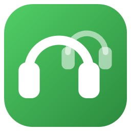

<p align="center">
  
</p>

<h1 align="center">MultiSound</h1>

<p align="center">
  Звук Windows сразу на несколько наушников —<br>
  проводные и Bluetooth, синхронно.
</p>

<p align="center">
  <a href="https://github.com/Alexpivo394/MultiSound/releases/latest"></a>
  <a href="https://github.com/Alexpivo394/MultiSound/actions/workflows/Build.yml"></a>
</p>

<p align="center">
  <b><a href="https://github.com/Alexpivo394/MultiSound/releases/latest">Скачать MultiSound.exe</a></b>
</p>

---

Вдвоём смотреть фильм на ноутбуке в поезде, каждый в своих наушниках. Windows так не умеет: звук идёт на одно устройство. MultiSound раздаёт его на два, три, четыре устройства сразу и выравнивает их по времени, чтобы проводные не опережали Bluetooth.

Это один `MultiSound.exe`. Он не ставит драйверов, не просит прав администратора и не требует установленного .NET — скачали и запустили.

## Как пользоваться

1. Подключите наушники и запустите `MultiSound.exe`.
2. Если среди них есть Bluetooth, нажмите на их карточке **«Сделать основным»**.
3. Отметьте переключателем остальные устройства и нажмите **«Запустить»**.
4. Подстройте задержку. Включите **«Щелчки для подстройки»**: раз в секунду на всех устройствах прозвучит щелчок. Наденьте по одному наушнику от двух пар и двигайте **«Сдвиг»** у проводных, пока щелчки не сольются в один. Для точной подстройки есть кнопки −10 и +10 мс. Затем выключите щелчки.

Подстраивать нужно один раз: сдвиг запоминается для каждого устройства.

Что ещё полезно знать:

- **Громкость** на карточке — это громкость самого устройства в Windows. Изменили её в Windows или кнопками наушников — ползунок обновится сам.
- **Крестик** прячет окно в трей, звук продолжает идти. Окно открывается щелчком по значку, выход — через меню значка, пункт **«Выход»**.
- **Отвалился Bluetooth-наушник** — остальные продолжат играть. Когда он подключится снова, звук на него вернётся сам.
- **При выходе** основным устройством Windows снова становится то, что было до запуска.

Настройки хранятся в `%AppData%\MultiSound\settings.json`.

## Как это работает


Программы играют на основное устройство Windows, как обычно. MultiSound записывает то, что на нём звучит, и раздаёт копии на остальные отмеченные устройства. Каждую копию можно задержать.

Отсюда главное правило: **основным должно быть самое медленное устройство**. Копия не может опередить оригинал, её можно только задержать. Обычно медленнее всех Bluetooth, поэтому основным делают его, а проводные выравнивают под него сдвигом.

Часы звуковых устройств немного расходятся, и за фильм набежала бы заметная разница. MultiSound незаметно подстраивает скорость каждой копии, поэтому выравнивание держится до конца.

## Ограничения

- Windows не сообщает точную задержку Bluetooth-наушников, поэтому сдвиг подстраивается на слух.
- Встроенный Bluetooth-адаптер ноутбука часто не тянет больше двух аудиопотоков сразу: звук заикается или пропадает. Помогает второй USB-адаптер Bluetooth.

## Сборка

Нужен .NET 10 SDK.

```powershell
dotnet build MultiSound.slnx
dotnet run --project tests/MultiSound.Tests
dotnet publish src/MultiSound.App -c Release -o out
```

После `publish` в папке `out` лежит готовый `MultiSound.exe`. Тег `X.Y.Z` собирает его на GitHub и выкладывает в релиз.

| Папка | Что там |
|---|---|
| `src/MultiSound.Audio` | Звуковой движок: захват, задержка и подстройка скорости копий, устройства |
| `src/MultiSound.App` | Окно на [ToadDesign](https://github.com/Alexpivo394/ToadDesign) и значок в трее |
| `tests/MultiSound.Tests` | Тесты на TUnit; проверки на реальных устройствах помечены `[Explicit]` |
| `tools/IconMaker` | Рисует иконку приложения в `src/MultiSound.App/Assets`: `dotnet run --project tools/IconMaker` |
